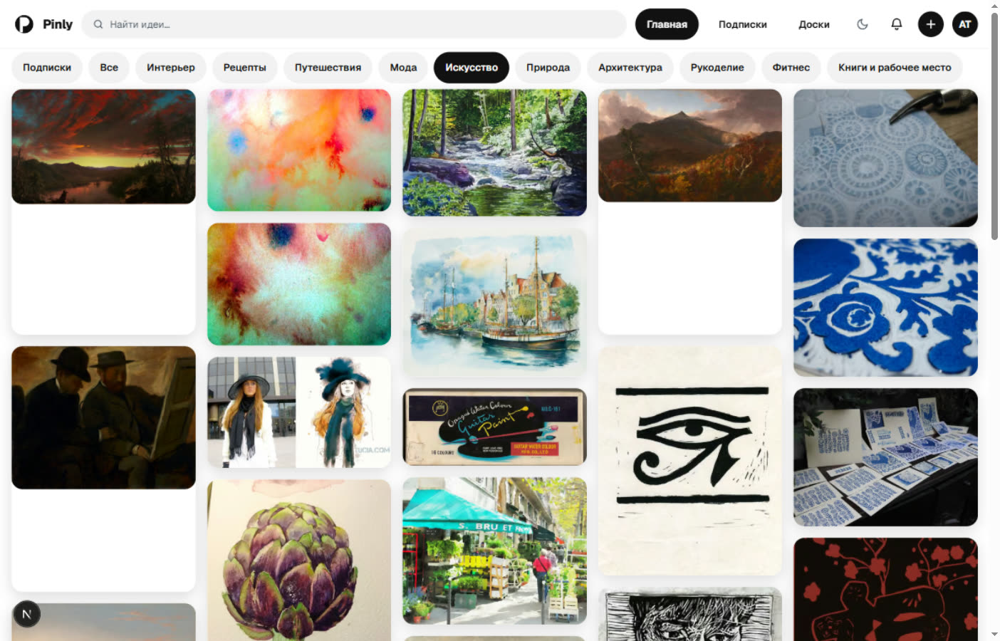
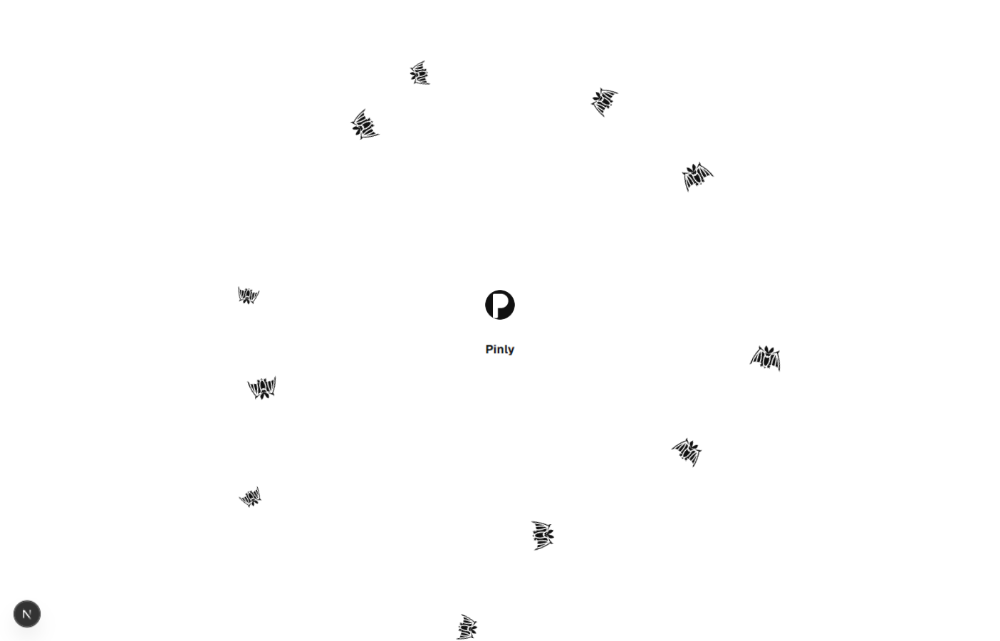
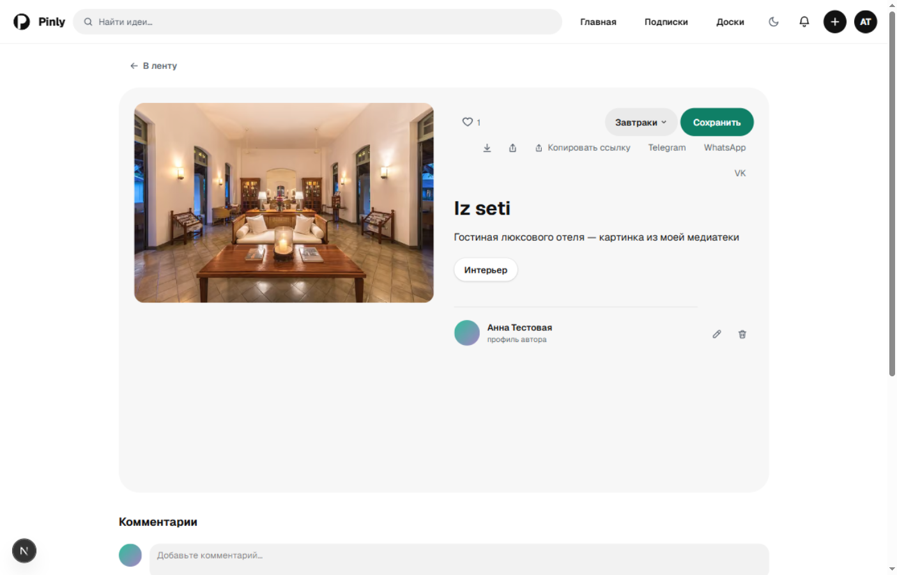
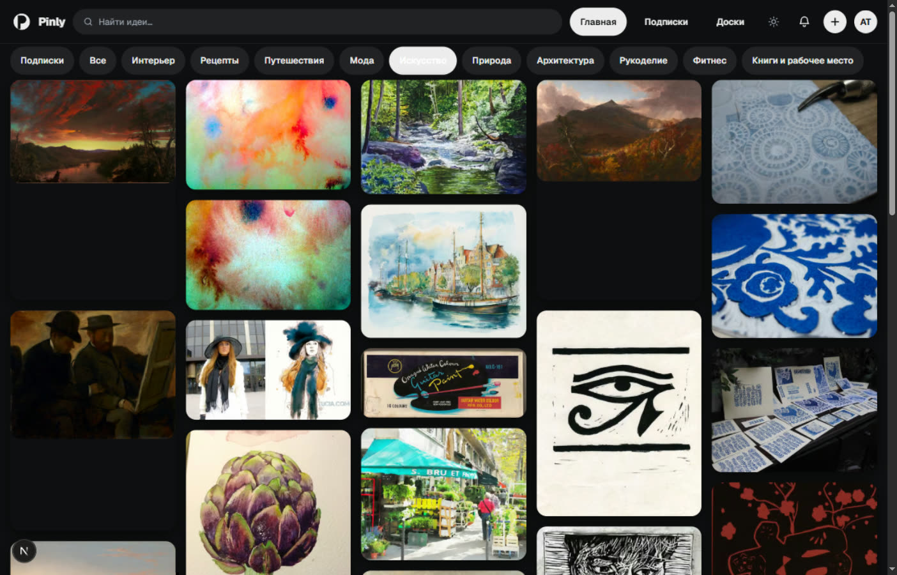

<div align="center">


# Pinly

**Визуальная лента идей — веб-аналог Pinterest, который работает в России без VPN, без ключей и без третьих сторон.**

Картинки приходят из открытых источников, аккаунты и доски лежат в моём же
Python-бэкенде на SQLite, оптимизацией картинок занимается свой прокси. Никто
чужой в цепочке не участвует: один `docker run` — и сайт целиком ваш, вместе с
данными и файлами пользователей.

[](https://github.com/Artemik0922/pinly-web/actions/workflows/ci.yml)




</div>

> ⚡ **Как запустить**
>
> ```bash
> npm ci && pip install -r backend/requirements.txt
> python -m uvicorn backend.app:app --port 8000   # аккаунты, доски, события
> npm run dev                                     # http://localhost:3000
> ```
>
> Без бэкенда сайт тоже открывается и работает — просто анонимно, с досками в
> localStorage. Это не урезанный режим, а обычный сценарий для демо на статик-
> хостинге.

---

## 📋 Оглавление

- [Что умеет](#-что-умеет)
- [Экраны](#-экраны)
- [Как устроено](#-как-устроено)
- [Откуда контент](#-откуда-контент)
- [Приватность и аккаунты](#-приватность-и-аккаунты)
- [Трафик, показы и цифры мастеру](#-трафик-показы-и-цифры-мастеру)
- [Умная лента](#-умная-лента)
- [Производительность](#-производительность)
- [Проверки и CI](#-проверки-и-ci)
- [Продакшн](#-продакшн)

---

## 🧩 Что умеет

| | Что там | Где смотреть |
| --- | --- | --- |
| **Лента** | масонри-сетка, инфинити-скролл, ротация категорий, вкладка «Подписки» | [`src/components/ui/MasonryGrid.tsx`](src/components/ui/MasonryGrid.tsx), [`src/lib/server/feed.ts`](src/lib/server/feed.ts) |
| **Пины** | страница с похожими, лайк, скачивание, «поделиться», комментарии, теги и автор; с чужого пина можно пожаловаться | [`src/components/pin/PinDetail.tsx`](src/components/pin/PinDetail.tsx), [`src/components/report/ReportButton.tsx`](src/components/report/ReportButton.tsx) |
| **Свои загрузки** | drag&drop, тип файла по сигнатуре, имя файла генерирует сервер; опционально внешний хостинг | [`backend/routers/pins.py`](backend/routers/pins.py), [`backend/pins.py`](backend/pins.py) |
| **Доски** | создание, переименование, удаление, коллажи-превью, секретные доски, публичная ссылка, по которой доску видят чужие | [`src/components/board/BoardView.tsx`](src/components/board/BoardView.tsx) |
| **Аккаунты** | регистрация, сессия httpOnly-cookie, аватар, удаление аккаунта с каскадом по всем данным | [`backend/accounts.py`](backend/accounts.py) |
| **Соцблок** | подписки, публичные профили и доски, комментарии, уведомления о лайке, комментарии и подписке | [`backend/routers/social.py`](backend/routers/social.py), [`backend/notifications.py`](backend/notifications.py) |
| **Поиск** | по названию, описанию, тегам и категории; с ключом — ещё и смысловой, по векторам. Выдача листается курсором, как лента. Плюс режим «по фото»: картинка → похожие пины | [`src/app/search/page.tsx`](src/app/search/page.tsx), [`src/components/search/PhotoPanel.tsx`](src/components/search/PhotoPanel.tsx), [`src/components/search/PhotoSourceMenu.tsx`](src/components/search/PhotoSourceMenu.tsx) |
| **Мелочи** | светлая и тёмная тема до первой отрисовки, тосты, подтверждение удаления, стартовый экран с роем мышей | [`src/app/layout.tsx`](src/app/layout.tsx) |

## 🖼 Экраны

| Маршрут | Что на нём |
| --- | --- |
| `/` | лента с фильтром по категориям (`/?category=…`) и вкладкой подписок (`/?feed=subscriptions`) |
| `/category/[slug]` | посадочная страница категории: свой `title`, `h1`, вступление и `canonical`. Именно её отдаю поисковику и кладу в sitemap |
| `/pin/[id]` | пин: описание, автор, теги, похожие, лайк, скачивание, комментарии, структурированные данные |
| `/pin/new` | загрузка своей картинки с сразу выбранной доской |
| `/search?q=…` | поиск по тексту, закрыт от индекса |
| `/search?by=image` | поиск по фото: меню источников — «Камера»/«Галерея» на телефоне, веб-камера, файл и буфер на ПК; можно перетащить или вставить через Ctrl+V |
| `/boards`, `/board/[id]` | список досок и одна доска; чужая открытая — просмотр и сигнал о проблеме |
| `/profile/[id]` | свой профиль с редактированием и удалением; чужой — публичная страница с подпиской |
| `/notifications` · `/media` · `/login` · `/signup` | уведомления, медиатека, вход и регистрация |

## 🛠 Как устроено

```
браузер
   │  один origin: http://хост:3000
   ▼
Next.js 16 (App Router, RSC, cacheComponents)
   ├── /api/feed, /api/img …… свои провайдеры в Node (Openverse, музеи, Commons)
   │                          + дисковый кэш .cache/
   └── rewrites /api/auth|boards|pins|uploads|users|comments|ev|notifications
        ▼
      FastAPI (backend/server.py) ── SQLite (.data/accounts.db, WAL)
                              └── файлы пользователей (.data/uploads)
```

Прокси один и тот же на всех этапах: `/api/*` уходят на тот же домен, поэтому
cookie-сессия ставится для сайта и CORS не нужен ни в браузере, ни в тестах.
Адрес бэкенда настраивается `ACCOUNTS_BACKEND_URL`.

| Слой | Файлы |
| --- | --- |
| Страницы (App Router) | [`src/app/`](src/app) |
| Компоненты — по доменам | [`ui/`](src/components/ui), [`layout/`](src/components/layout), [`feed/`](src/components/feed), [`pin/`](src/components/pin), [`board/`](src/components/board), [`chat/`](src/components/chat), [`profile/`](src/components/profile) |
| REST-клиент: по одному модулю на домен бэкенда | [`src/lib/api/`](src/lib/api) |
| Серверный слой ленты и провайдеры (node-only) | [`src/lib/server/`](src/lib/server) |
| Клиентские состояния: сессия, доски, лайки | [`src/lib/state/`](src/lib/state) |
| Модель пина (общий контракт для моков, источников и загрузок) | [`src/lib/pin.ts`](src/lib/pin.ts) |
| Бэкенд: сервисы доменов + HTTP-роутеры | [`backend/`](backend), [`backend/routers/`](backend/routers) |
| Тесты | [`backend/tests/`](backend/tests), [`e2e/pinly.spec.ts`](e2e/pinly.spec.ts) |

<details>
<summary>📁 Дерево проекта целиком</summary>

```
src/
  app/                 — страницы, sitemap.ts, robots.ts
  data/mock-pins.ts    — моки (fallback) для ленты без внешнего API
  lib/
    pin.ts             — тип Pin и размеры/URL картинки; клиент-безопасный
    api/               — REST-клиент: http.ts (транспорт) + auth, boards,
                         likes, pins, social, media, notifications, chats, feed
    state/             — клиентские провайдеры: session.tsx (useUser),
                         boards.tsx (useBoards), likes.tsx (useLikes),
                         board-storage.ts (локальный режим и миграция в БД)
    server/            — только Node: feed.ts (лента, векторный вкус, похожие),
                         backend.ts (запросы к Python-бэкенду), meta.ts, seo.ts,
                         img-proxy.ts (правила /api/img), vector-store.ts,
                         queries.ts, providers/ (openverse, extras, cache,
                         embeddings)
    storage.ts         — localStorage без исключений в приватном режиме
    share.ts           — нативный sheet и копирование ссылки с запасным путём
    image-dims.ts      — размеры картинки до загрузки
    categories.ts      — slug'и и тексты посадочных страниц категорий
    plural.ts, time.ts — русские счётчики и «5 минут назад»
    site.ts, track.ts  — базовый адрес сайта; счётчик событий
  components/
    ui/                — Avatar, MasonryGrid, Toast, Confirm, Field, Icons,
                         SkeletonGrid, ThemeToggle, LogoMark, CategoryChips
    layout/            — Header, Splash
    feed/              — HomeFeed, InfiniteFeed, PinCard, SubscriptionsFeed
    pin/               — PinDetail, PinActions, OwnerControls, Comments,
                         SaveControls
    board/             — BoardView, BoardStats, PublicBoardCard
    chat/              — ChatView, useChatThread, MessageList, MessageRow,
                         ChatHeader, Composer, PinAttachment, SendPinDialog,
                         PinPickerDialog
    profile/           — ProfileView, PublicProfile, ProfileEditor
backend/
  app.py               — точка входа ASGI: `uvicorn backend.app:app` и `app:app`
  server.py            — сборка приложения: логи, CORS, request-id, порядок маршрутов
  db.py                — одна схема SQLite, упорядоченные миграции, соединение на запрос
  deps.py              — Depends: current_user (401), optional_user, session_payload
  schemas.py           — pydantic-модели всех принимаемых тел (падеж клиента — контракт)
  erasure.py           — единственное место, где каскад стирает строки всех доменов
  session.py            — секрет подписи, JWT HS256 и httpOnly-кука сессии
  ratelimit.py          — счётчик «action:ip» для входа, записи и событий
  accounts.py           — пароли (PBKDF2), таблица users, журнал согласий
  boards.py likes.py pins.py media.py uploads.py chats.py social.py
  notifications.py events.py seo.py mealdb.py feed.py imgproxy.py
                       — сервисы доменов: запросы к БД и правила, без HTTP
  routers/             — HTTP-слой: auth, boards, likes, pins, media, social,
                         chats, notifications, events, seo, mealdb, feed, img
  images.py cache.py embeddings.py mock-pins.json
  tests/               — pytest-контур (изолированная .data)
e2e/                   — Playwright-смоук
scripts/               — warm (прогрев кэша), index (эмбеддинги пинов),
                         probe-embeddings (что принимает провайдер), make-logo, make-hero
Dockerfile             — образ «Next + FastAPI» (порт 3000, том /app/.data)
```

</details>

## 🌍 Откуда контент

Лента собирается из нескольких открытых источников; все они доступны из РФ без
ключей и VPN.

| Источник | Что даёт | Категории |
| --- | --- | --- |
| [Openverse](https://api.openverse.org/v1/) | основной поток картинок (flickr, wikimedia и др.) | все |
| [Метрополитен-музей](https://metmuseum.github.io/), [Кливленд](https://openaccess.clevelandart.org/) | собрания общественного достояния | Искусство, Архитектура, Мода |
| Wikimedia Commons напрямую | общий фид и поиск | Природа, Путешествия и остальные |
| [TheMealDB](https://www.themealdb.com/api.php) | блюда с фотографиями | Рецепты |

Запросы кэшируются на диск (`.cache/`), а картинки отдаются через собственный
прокси `/api/img`. Благодаря этому один и тот же запрос уходит в API раз в
сутки, и лимиты Openverse (анонимно 20 запросов в минуту и 200 в день)
перестают быть лимитами сайта. Если источник недоступен, включается
экспоненциальная пауза, его вклад пустеет, а лента падает на локальные моки
([`src/data/mock-pins.ts`](src/data/mock-pins.ts)) — пустых экранов не бывает. Автора
картинки и лицензию видно прямо на странице пина.

`npm run warm` прогревает кэш заранее. Без него первый посетитель платит
задержкой внешнего API, а не сайта.

## 🔒 Приватность и аккаунты

Один бэкенд, без внешних сервисов авторизации. FastAPI хранит пользователей,
доски, пины, лайки, подписки и комментарии в SQLite (`.data/accounts.db`),
сессия — httpOnly-cookie с подписанным JWT на 30 дней, пароли —
PBKDF2-HMAC-SHA256.

> 🕵️ **Что не хранится вообще**
>
> IP, email и любые произвольные строки клиента в базу не попадают. Посетитель
> события — `sha256(секрет + IP + дата)`: суточный счётчик уникальных, который
> нельзя склеить в историю одного человека. Из реферера остаётся только хост.
> Email наружу не отдаётся никогда: в публичных ответах есть только имя, которое
> человек ввёл сам. При удалении аккаунта он исчезает и из журнала согласий:
> строка остаётся (версия документа, UA, дата — это доказательство), но вместо
> адреса в ней HMAC-метка, которую без секрета сервера не сопоставить с почтой.

- Удаление аккаунта стирает доски, пины, файлы, лайки, подписки и комментарии.
  Мягких копий не остаётся ни в одной таблице.
- Сброса пароля по почте нет, и это пока осознанный пробел: для него нужен
  почтовый контур, а с ним адреса уезжают туда, где их читает кто-то ещё.
  Вход держится 30 дней, так что острая необходимость не каждый день.
- Реклама планируется контекстной (категория, запрос, тема доски), а не по
  профилю человека. Следящих cookie на сайте нет.
- Лайк теперь тоже под потолком частоты: каждый лайк пишет уведомление владельцу
  пина, и без лимита «лайк» превращается в канал доставки до кого угодно.
- Публичные **читалки** (`/api/boards/{id}/public`, `/api/users/*`) лимитом не
  закрыты намеренно. Их главный читатель — поисковый краулер, а Node ходит в
  бэкенд с одного адреса: потолок по IP ударил бы и по обходу, и по всем
  посетителям сразу, а интерфейс сегодня не умеет отличать 429 от «не найдено».
  Прежде чем лимитить чтение, нужно проксировать адрес посетителя из Node
  (`X-Forwarded-For` + `PINLY_TRUST_PROXY`) и добавить честное состояние «вы
  слишком часто просите».

## 📈 Трафик, показы и цифры мастеру

Модель монетизации — реклама, то есть выручка = показы × CPM. Отсюда две вещи,
которых у локальной витрины не было: индексируемые страницы и честный счётчик
пришедших людей.

| | Что сделано |
| --- | --- |
| **Страницы** | у ленты по категории есть постоянный адрес `/category/<slug>` со своим заголовком, `h1`, вступлением и `canonical`. Без уникального текста десять одинаковых лент склеиваются в дубли. Старый `/?category=` оставил живым — ссылки уже разосланы, — но закрыл от обхода в [`src/app/robots.ts`](src/app/robots.ts) |
| **Карта сайта** | `sitemap.xml` читает базу через `GET /api/seo/urls` ([`backend/seo.py`](backend/seo.py)): настоящие пины, открытые доски и профили вместо списка мок-картинок. Секретные доски отсекаются прямо в SQL, в ответе только пути и даты. Бэкенд молчит — карта остаётся статической, но не падает |
| **События** | `POST /api/ev?name=…&board=…&pin=…&category=…&source=…` ([`backend/events.py`](backend/events.py)), отправка из [`src/lib/track.ts`](src/lib/track.ts) через `sendBeacon` с запасным `fetch keepalive`. Дубли гасятся на клиенте: в dev-строгом режиме эффект монтируется дважды, и показы считались бы дважды. Мерится `visit`, `pin_view`, `board_view`, `board_created`, `pin_save`, `share_copy`, `signup_open` и `report` — жалоба на пин или доску, где причина лежит в `source`, а в сводке ей отдельный блок `reports` (очереди модерации нет: сигнал читает человек по адресу из политики) |
| **Цифры мастеру** | `GET /api/ev/board?board=<id>&days=14` доступен только владельцу доски: чужой запрос получает 403, без сессии — 401. Ответ — одни счётчики: показы по дням, откуда приходили, сколько раз копировали ссылку. Свои просмотры считаются отдельно от чужих, иначе человек меряет себя и допущение «расшаренная доска приводит людей» нельзя ни подтвердить, ни опровергнуть. На экране это панель «Цифры доски» |
| **Пометка канала** | «Поделиться» ставит в ссылку `?from=link`, а системный шаринг — `?from=share`. В мессенджерах Referer теряется чаще, чем доживает, и без метки весь чужой трафик ложился бы в «напрямую» |

Глобальная сводка — `GET /api/ev/summary?days=7`. В проде её видит только
аккаунт `PINLY_OWNER_EMAIL`, а если адрес не задан, эндпоинт вовсе отключён (404).

```bash
curl -s localhost:3000/api/ev/summary?days=7 -H "Cookie: pinly_session=…"
```

### Что реально видит краулер

`npm run seo:report` ([`scripts/seo-report.mjs`](scripts/seo-report.mjs)) берёт
публичный `sitemap.xml` и обходит адреса обычным `fetch` — без браузера и без
гидрации. Считает два числа, потому что одно без другого вводит в заблуждение:

- **поток** — ссылки в основном HTML; это увидит парсер, который не исполняет
  JavaScript;
- **payload** — ссылки во всём ответе, включая скрытые блоки
  `<div hidden id="S:n">`, которые React донашивает скриптом.

Замер 2026-11-01 на локальной базе:

| Тип адресов | В карте | Поток | Payload до серверного прохода | Payload после |
| --- | --- | --- | --- | --- |
| `/category/<slug>` | 10 | 0 | 14–20 | 14–20 |
| `/pin/<id>` | 11 | 0 | 7–8 | 7–8 |
| `/board/<id>` | 246 | 0 | **0** | 1+ и JSON-LD `CollectionPage` |
| `/profile/<id>` | 114 | 0 | **0** | 1–4 ссылки на доски, `ProfilePage`, og:image из первой работы |

Три честные вещи из этой таблицы.

**Первая:** при `cacheComponents`/PPR любая динамическая страница отдаётся как
статический шелл с `<template>`-дырой, а серверный контент приезжает в скрытом
блоке и показывается скриптом. Поэтому **поток пуст у всех страниц сразу** — не
только у досок. Google и Яндекс JavaScript исполняют и видят содержимое;
парсер без JS — нет. Чтобы доска мастера стала видна и ему, нужен пререндер
адресов (`generateStaticParams` + инвалидация по тегу), а это отдельное
решение, не «починить опечатку».

**Вторая:** серверный проход `/board/<id>` всё равно нужен и без него не
обходиться: раньше в ответе доски не было **ни одной** работы — ни в потоке, ни
в payload. Теперь есть сетка и `CollectionPage` c `ItemList`, а гостю не
приходится допрашивать бэкенд после гидрации.

**Третья:** `/profile/<id>` был в `sitemap.xml` с адресами живых мастеров, но
собирался целиком в браузере — поисковик индексировал пустоту ровно там, где
человек показывает работы. Теперь витрина (карточка, открытые доски, первая
порция пинов, `ProfilePage`) приезжает с сервера, а гость не платит бэкенду
повторный запрос. Профиль мастера с сотней загрузок отдаёт в HTML первые 24 —
остальное догружается кнопкой, счётчик в шапке всегда полный.

Ещё две находки того же замера: `sitemap.ts` кэшировал ответ бэкенда на 10
минут **вместе с пустым результатом** (мигровой сбой вычёркивал доски и
профили из публичной карты), и при пустом `NEXT_PUBLIC_SITE_URL` весь canonical
и og:image уезжают на `localhost` — в проде переменная обязательна.

## 🧠 Умная лента

Для вошедших первые ~80% страницы подбираются по вектору вкуса: сумма векторов
лайкнутых (вес 1) и сохранённых (вес 2) пинов из `.cache/vectors.json`, и
ближайшие к ней пины, кроме уже отмеченных. Остальные ~20% — обычная ротация
категорий. Подборка кэшируется на 10 минут, id лайков и сохранений отдаёт
`GET /api/taste/pins`.

Всё это включается ключом `EMBED_API_KEY` и индексом `npm run index`. Без них
лента остаётся обычной: деградация прозрачна для пользователя и не ломает ни
один тест.

## 📷 Поиск по фото

`POST /api/search/image` принимает картинку (до 5 МБ, тип определяется по
сигнатуре байтов, а не по заголовку запроса), отдаёт её в
`voyageai/voyage-multimodal-3.5` и ищет ближайшие векторы в том же
`.cache/vectors.json`. Модель мультимодальная — текст и картинка лежат в одном
пространстве, поэтому запрос-фото находит и пины, проиндексированные по тексту.
Отдельный проход `npm run index -- --images` добавляет в индекс векторы самих
картинок: так «найди похожее» сравнивает фотографию с фотографией, а стиль и
композиция в тексте описаны плохо.

Включается в таком порядке (каждый шаг проверяем `npm run probe:embeddings`):

```bash
EMBED_API_KEY=…        # web/.env.local, скрипты читают файл сами
npm start              # сайт + прокси картинок
npm run warm           # кэш ленты и оригиналов
npm run index          # текстовые векторы
npm run index -- --images   # векторы картинок
```

Честные состояния вместо пустой сетки: без ключа или без индекса — 503 с
объяснением, что запустить; мусор вместо картинки — 400; больше 5 МБ — 413;
провайдер молчит — 502 и кнопка «Попробовать ещё». Каждый запрос — платный
вызов API, поэтому частота ограничена 20 в минуту на адрес (счётчик в памяти
процесса, смысл — «не спамь», а не квота).

Формат запроса с картинкой RouterAI в документации не описан: `embeddings-wire.mjs`
перебирает три правдоподобных и запоминает победителя. Замер без ключа
2026-10-31: `/embeddings` жив (401 со штатным JSON), `/multimodalembeddings` —
`404 page not found`, значит собственные voyage-эндпоинты роутер не проксирует.
Какой формат принят на самом деле, видно по `npm run probe:embeddings` — он же
проверяет, что косинус «текст своего пина ↔ картинка своего пина» выше, чем до
чужого пина.

## ⚡ Производительность

Замерял Lighthouse-трейсом DevTools и повторяемым прогоном Playwright — LCP и
CLS по 4–5 заходам, потому что с одного замера доверия им нет.

| Метрика | Было | Стало |
| --- | --- | --- |
| LCP главной (десктоп, без троттлинга) | 867 мс | **288 мс** |
| CLS | сетка скакала на загрузке картинок | **0.00** |
| 20 карточек первого экрана | растровые оригиналы | **≈144 КБ AVIF** |
| TTFB страницы категории (прогретый прод) | — | **≈44 мс** |

<details>
<summary>🧵 Что держит эти цифры и почему это неочевидно из кода</summary>

- **Карточки ленты не прячутся до загрузки картинки.** Место резервируется
  `aspect-ratio` коробки, поэтому сетка не пересобирается пачкой. Прежний
  `display:none` с опросом каждые 150 мс давал reflow на ~55 мс, полсотни
  висящих узлов и держал LCP на 500 мс дольше.
- **`connection()` вызывается в корне страницы, а не под `Suspense`.** Иначе
  отдаётся статическая оболочка, а лента догоняет отдельным запросом после
  гидрации: картинки стартуют на ~450 мс позже, чем могли бы, и краулер видит
  страницу без пинов.
- **Приоритет только у первых 4 карточек** (`fetchPriority="high"` + eager).
  Больше — хуже: с 10 приоритетными картинками LCP вырос со 156 мс до 292, они
  вытесняют друг друга с одного канала. `column-fill: balance` в CSS-колонках
  означает, что порядок в DOM ≠ порядок на экране, поэтому запас тут
  сознательный, а не точный.
- **Картинки идут через `next/image` в AVIF/WebP** с ограниченным набором
  ширин: 100..7000 с шагом выносило бы в кэш отдельную копию на каждый размер.
  Моки ленты — исключение, они грузятся с внешнего хоста напрямую, потому что
  оптимизатор до weserv не достучится.
- **Моноширинный веб-шрифт удалён.** Класс не использовался ни в одном
  компоненте, а запрос и ~20 КБ были.
- На CPU×4 прогретая страница держит 200–500 мс. Холодный кэш источников —
  единственное, что способно затормозить сайт заметно, и для этого есть
  `npm run warm`.

</details>

## ✅ Проверки и CI

```bash
npm run typecheck          # next typegen + tsc --noEmit
npm run lint               # eslint
npm run test:api           # pytest: валидация, права, каскады, кэш — без сети
npm run test:e2e           # Playwright: лента, регистрация, комментарий, поиск,
                           #               категория, превью доски, её цифры
npm run ui:audit           # дизайн-система: ширины, радиусы, сетка, тап-цели,
                           #               кегль на 390 и 1280 (нужен сервер)
npm run build              # продакшн-сборка
```

Визуальные правила записаны в [`DESIGN.md`](DESIGN.md) — не для красоты, а
потому что `ui:audit` сверяет с ними вычисленные стили живых страниц и падает,
если новый экран принёс «ещё одну красивую ширину контейнера».

CI ([`.github/workflows/ci.yml`](.github/workflows/ci.yml)) гоняет это тремя
работами: `frontend` (типы, линт, сборка на Node 22), `backend` (pytest на
Python 3.13) и `e2e`, которая стартует только после двух зелёных.

Второй рабочий файл — [`warm.yml`](.github/workflows/warm.yml): каждый час в :17 он запускает `node scripts/warm.mjs` по адресу из секрета `WARM_URL` и тем самым греет кэш прода. Без секретов задача проходит пусто, так что форкать репозиторий безопасно.

Два момента, на которых тесты врут, если о них не знать:

- 🌐 Origin должен быть `http://localhost:3000`, а не `127.0.0.1`. Next 16
  блокирует dev-ресурсы по чужому origin, гидрация не доходит, и каждый
  селектор клиентского компонента падает как «элемент не найден». На этом я
  погорел один раз целиком.
- 🔁 `test:e2e` поднимает dev-сервер сам, но бэкенд на :8000 нужно запускать
  отдельно. Лимиты частоты живут в памяти процесса, поэтому после тяжёлого
  прогона бэкенд лучше перезапустить: иначе 429 выглядит как сломанная фича.

## 🚀 Продакшн

```bash
docker build -t pinly .
docker run -d -p 3000:3000 -v pinly-data:/app/.data \
  -e PINLY_JWT_SECRET="$(openssl rand -hex 32)" \
  -e PINLY_ENV=production \
  -e NEXT_PUBLIC_SITE_URL=https://pinly.example \
  -e PINLY_TRUST_PROXY=1 \
  pinly
```

Без Docker: `npm run build && npm start` рядом с
`uvicorn backend.app:app --port 8000` за nginx или Caddy. Наружу проксируется
только 3000 — `/api/*` уже проксируются внутри Next.

| Переменная | Зачем |
| --- | --- |
| `NEXT_PUBLIC_SITE_URL` | домен в `canonical`, OG-ссылках и `sitemap.xml`. Без него всё это указывает на `localhost:3000` |
| `PINLY_REQUIRE_SITE_URL=1` | сборка падает, если домен пуст: молчаливый `localhost` в canonical заметен только через неделю пустых кликов |
| `PINLY_JWT_SECRET` | подпись сессий. Иначе секрет генерируется один раз в `.data/secret.key`, а в проде сервер не стартует, если секрет не переживёт перезапуск |
| `PINLY_ENV=production` | включает жёсткие проверки и закрывает сводку событий для посторонних |
| `PINLY_TRUST_PROXY` | разрешает читать `X-Forwarded-For`, но только за своим reverse-proxy. Иначе лимиты обходятся одной строчкой в curl |
| `PINLY_OWNER_EMAIL` | единственный аккаунт, которому видна глобальная сводка `/api/ev/summary` |
| `ACCOUNTS_BACKEND_URL` | адрес Python-бэкенда, если он не на :8000 этой же машины |
| `OPENVERSE_API_KEY` | поднимает лимиты источника с 200/день до 10000/день |
| `EMBED_API_KEY` | включает смысловой поиск, умную ленту и поиск по фото (`npm run index`, `npm run index -- --images`) |
| `IMGBB_API_KEY` | опциональный внешний хостинг картинок, если своих дисков жалко |
| `PINLY_DATA_DIR` | каталог с базой и загрузками — на другой диск или том |

Полный список с комментариями лежит в [`.env.example`](.env.example). Бэкапить
нужно `.data`: там база и файлы пользователей. `.cache` потеря переживёт — он
пересоздаётся.

<details>
<summary>☁️ Фронтенд на Netlify, без бэкенда</summary>

Репозиторий готов к импорту: `netlify.toml` уже настроен. В Netlify —
**Add new site → Import an existing project → GitHub**; команда сборки и плагин
Next.js подтянутся из `netlify.toml`.

- 🐍 Python-бэкенда на Netlify нет. Сайт работает в анонимном режиме (доски и
  лайки в localStorage) — это штатный сценарий, а не костыль. Бэкенд поднимается
  отдельно и подключается `ACCOUNTS_BACKEND_URL`.
- 🔗 После первого деплоя задайте `NEXT_PUBLIC_SITE_URL=https://<имя>.netlify.app`
  и сделайте **Clear cache and deploy site**, иначе `canonical` и OG-ссылки
  останутся на старом домене.
- ⚙️ `/api/feed` и `/api/img` работают как Netlify Functions из коробки, их
  поднимает `@netlify/plugin-nextjs`.

</details>

## 📸 Скриншоты

<table>
  <tr>
    <td width="33%" align="center"></td>
    <td width="33%" align="center"></td>
    <td width="33%" align="center"></td>
  </tr>
  <tr>
    <td align="center">🦇 Стартовый экран: из знака вылетает рой летучих мышей</td>
    <td align="center">📌 Страница пина: лайк, скачивание, «поделиться», комментарии</td>
    <td align="center">🌗 Тёмная тема — включается до первой отрисовки, без мигания</td>
  </tr>
</table>
