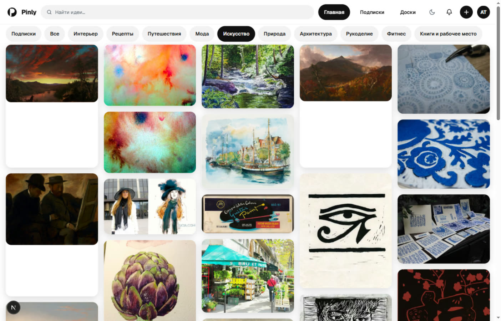
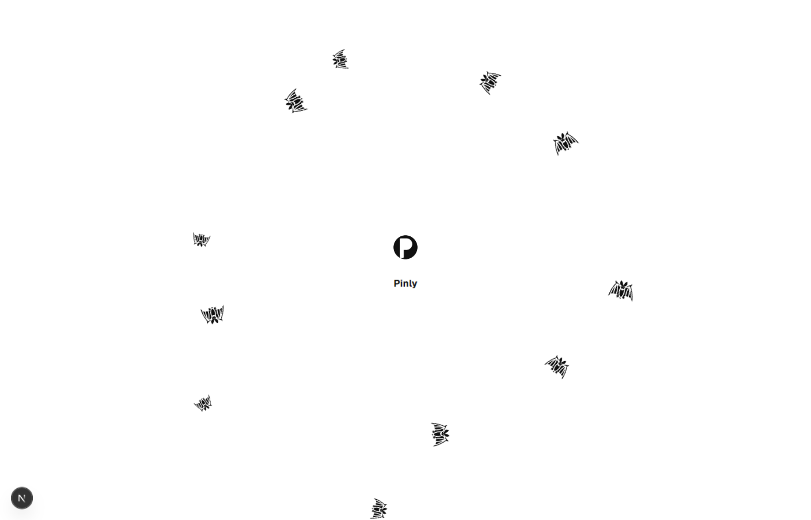
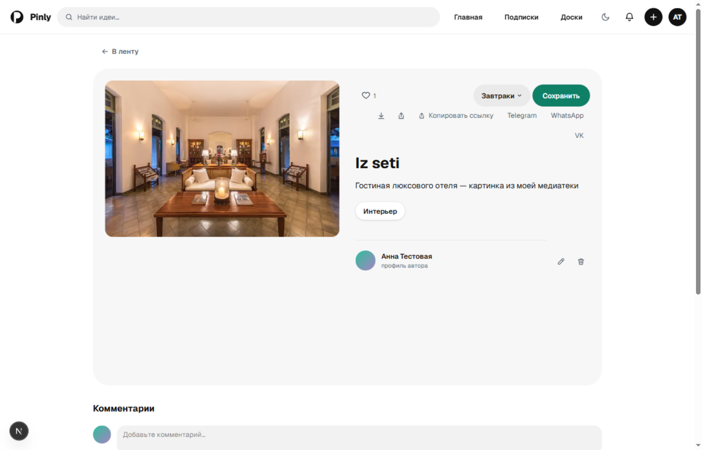
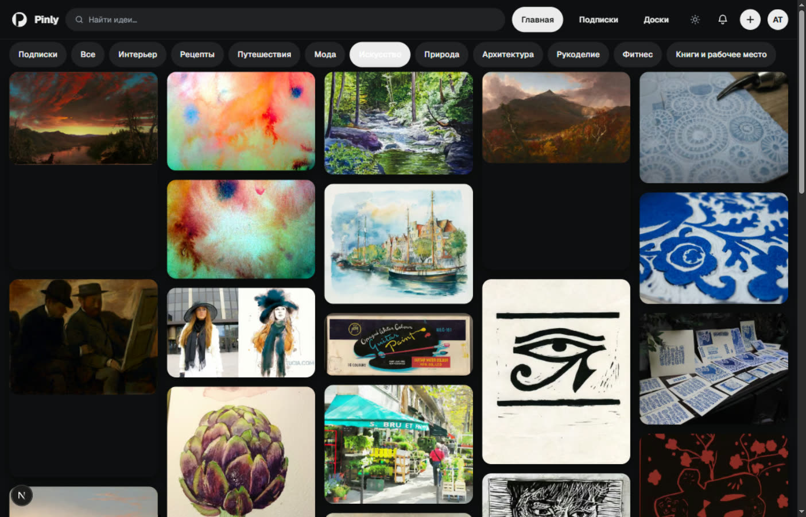

<div align="center">


# Pinly

**Визуальная лента идей — веб-аналог Pinterest, который работает в России без VPN, без ключей и без третьих сторон.**

Контент приходит из открытых источников, аккаунты и доски живут в собственном
Python-бэкенде на SQLite, картинки оптимизирует свой прокси. Один `docker run` —
и сайт целиком ваш: код, данные и файлы пользователей.

[](https://github.com/Artemik0922/pinly-web/actions/workflows/ci.yml)




</div>

> **Запуск тремя командами**
>
> ```bash
> npm ci && pip install -r backend/requirements.txt
> python -m uvicorn backend.app:app --port 8000   # аккаунты, доски, события
> npm run dev                                     # http://localhost:3000
> ```
>
> Без бэкенда сайт тоже работает — анонимно, с досками в localStorage.

---

## Оглавление

- [Что умеет](#что-умеет)
- [Экраны](#экраны)
- [Как устроено](#как-устроено)
- [Откуда контент](#откуда-контент)
- [Аккаунты, приватность и 152-ФЗ](#аккаунты-приватность-и-152-фз)
- [Трафик, показы и цифры мастеру](#трафик-показы-и-цифры-мастеру)
- [Умная лента](#умная-лента)
- [Производительность](#производительность)
- [Проверки и CI](#проверки-и-ci)
- [Продакшн](#продакшн)
- [Куда движется](#куда-движется)

---

## Что умеет

| Домен | Что есть | Где смотреть |
| --- | --- | --- |
| Лента | масонри-сетка, инфинити-скролл, ротация категорий, вкладка «Подписки» | [`src/components/MasonryGrid.tsx`](src/components/MasonryGrid.tsx), [`src/lib/feed.ts`](src/lib/feed.ts) |
| Пины | страница с похожими, лайк, скачивание, «поделиться», комментарии, теги и атрибуция лицензии | [`src/components/PinDetail.tsx`](src/components/PinDetail.tsx) |
| Свои загрузки | drag&drop, тип по сигнатуре файла, имя генерирует сервер; опционально — внешний хостинг | [`backend/pins.py`](backend/pins.py) |
| Доски | создание, переименование, удаление, коллажи-превью, секретные доски, публичная ссылка для чужого просмотра | [`src/components/BoardView.tsx`](src/components/BoardView.tsx) |
| Аккаунты | регистрация с согласием на обработку ПДн, сессия httpOnly-cookie, аватар, удаление аккаунта с каскадом | [`backend/accounts.py`](backend/accounts.py) |
| Соцблок | подписки, публичные профили и доски, комментарии, уведомления о лайке/комментаре/подписке | [`backend/social.py`](backend/social.py), [`backend/notifications.py`](backend/notifications.py) |
| Поиск | по названию, описанию, тегам и категории; с ключом — ещё и смысловой, по векторам | [`src/app/search/page.tsx`](src/app/search/page.tsx) |
| Темы и мелочи | светлая/тёмная тема до первой отрисовки, тосты, подтверждение удаления, стартовый экран | [`src/app/layout.tsx`](src/app/layout.tsx) |

## Экраны

| Маршрут | Назначение |
| --- | --- |
| `/` | лента с фильтром по категориям (`/?category=…`) и вкладкой подписок (`/?feed=subscriptions`) |
| `/category/[slug]` | посадочная страница категории: свой `title`, `h1`, вступление и `canonical` — то, что можно отдать поисковику и положить в sitemap |
| `/pin/[id]` | пин: описание, автор, теги, похожие, лайк, скачивание, комментарии, структурированные данные |
| `/pin/new` | загрузка своей картинки с сразу выбранной доской |
| `/search?q=…` | поиск (закрыт от индекса) |
| `/boards`, `/board/[id]` | список досок и одна доска; чужая открытая — read-only |
| `/profile/[id]` | свой профиль с редактированием и удалением; чужой — публичная страница с подпиской |
| `/notifications`, `/media`, `/login`, `/signup` | уведомления, медиатека, вход и регистрация |

## Как устроено

```
браузер
   │  один origin: http://хост:3000
   ▼
Next.js 16 (App Router, RSC, cacheComponents)
   ├── /api/feed, /api/img …… свои провайдеры в Node (Openverse, музеи, Commons)
   │                          + дисковый кэш .cache/
   └── rewrites /api/auth|boards|pins|uploads|users|comments|ev|notifications
        ▼
      FastAPI (backend/app.py) ── SQLite (.data/accounts.db, WAL)
                              └── файлы пользователей (.data/uploads)
```

Прокси один и тот же на всех этапах: `/api/*` идут с того же домена, поэтому
cookie-сессия ставится для домена сайта и CORS не нужен ни в браузере, ни в
тестах. Адрес бэкенда настраивается `ACCOUNTS_BACKEND_URL`.

| Слой | Файлы |
| --- | --- |
| Страницы (App Router) | [`src/app/`](src/app) |
| Компоненты | [`src/components/`](src/components) |
| Серверный слой ленты и провайдеры | [`src/lib/feed.ts`](src/lib/feed.ts), [`src/lib/providers/`](src/lib/providers) |
| Клиентские состояния (доски, лайки, сессия) | [`src/lib/store.tsx`](src/lib/store.tsx), [`src/lib/likes.tsx`](src/lib/likes.tsx), [`src/lib/user.tsx`](src/lib/user.tsx) |
| Бэкенд | [`backend/`](backend) |
| Тесты | [`backend/tests/`](backend/tests), [`e2e/pinly.spec.ts`](e2e/pinly.spec.ts) |

<details>
<summary>Полное дерево проекта</summary>

```
src/
  data/pins.ts         — моки (fallback) + контракт типов Pin
  lib/feed.ts          — серверный слой ленты: Openverse → моки, векторный
                         поиск, персональная подборка
  lib/categories.ts    — slug'и и тексты посадочных страниц категорий
  lib/track.ts         — счётчик событий (sendBeacon + fetch keepalive)
  lib/meta.ts, site.ts — заголовки/OG для серверных страниц
  lib/providers/       — openverse.ts (API), cache.ts (кэш + backoff),
                         proxy.ts (/api/img), embeddings.ts (ROUTERAI)
  lib/queries.ts       — поисковые запросы категорий
  lib/store.tsx        — доски и сохранения: аноним — localStorage,
                         вошедший — БД бэкенда
  lib/account.ts       — REST-клиент аккаунтов, пинов и соцблока
  lib/vector-store.ts  — .cache/vectors.json: косинусный поиск по эмбеддингам
  components/          — Header, CategoryChips, MasonryGrid, PinCard,
                         SaveControls, InfiniteFeed, PinDetail, Comments,
                         ProfileView, BoardView, BoardStats, SubscriptionsFeed,
                         Avatar, Splash, Toast, Confirm, Icons
  app/                 — страницы, sitemap.ts, robots.ts
backend/
  app.py               — лента/поиск/картинки + сборка приложения, /healthz
  accounts.py          — регистрация, сессии, доски, лайки, taste (SQLite)
  pins.py              — свои пины: загрузка, раздача файлов, правка
  social.py            — подписки, комментарии, публичные профили и доски
  notifications.py     — уведомления автору пина/комментария
  events.py            — приём событий и сводки (глобальная и по доске)
  seo.py               — GET /api/seo/urls: адреса для sitemap.xml
  images.py            — определение типа по сигнатуре
  tests/               — pytest-контур (изолированная .data)
e2e/                   — Playwright-смоук
scripts/               — warm (прогрев кэша), index (эмбеддинги), make-logo, make-hero
Dockerfile             — образ «Next + FastAPI» (порт 3000, том /app/.data)
```

</details>

## Откуда контент

Лента собирается из нескольких открытых источников — все доступны из РФ без
ключей и VPN:

| Источник | Что даёт | Категории |
| --- | --- | --- |
| [Openverse](https://api.openverse.org/v1/) | основной поток картинок (flickr, wikimedia и др.) | все |
| [Метрополитен-музей](https://metmuseum.github.io/), [Кливленд](https://openaccess.clevelandart.org/) | собрания общественного достояния | Искусство, Архитектура, Мода |
| Wikimedia Commons напрямую | общий фид и поиск | Природа, Путешествия и остальные |
| [TheMealDB](https://www.themealdb.com/api.php) | блюда с фотографиями | Рецепты |

Запросы кэшируются на диск (`.cache/`), картинки отдаются через собственный
прокси `/api/img` — так один и тот же запрос уходит в API раз в сутки, а
лимиты Openverse (анонимно 20/мин и 200/день) перестают быть лимитами сайта.
Источник недоступен — включается экспоненциальная пауза на этот источник, его
вклад просто пустеет, и лента прозрачно падает на локальные моки
([`src/data/pins.ts`](src/data/pins.ts)): пустых экранов не бывает. Атрибуция
автора и лицензия показываются на странице пина — это требование самих лицензий.

`npm run warm` прогревает кэш заранее: иначе первый посетитель платит
задержкой внешнего API, а не сайта.

## Аккаунты, приватность и 152-ФЗ

Один бэкенд, без внешних сервисов авторизации: FastAPI хранит пользователей,
доски, пины, лайки, подписки и комментарии в SQLite (`.data/accounts.db`),
сессия — httpOnly-cookie с подписанным JWT на 30 дней, пароли —
PBKDF2-HMAC-SHA256.

> **Что не хранится вообще**
>
> IP, email и любые произвольные строки клиента не попадают в базу. Посетитель
> события — `sha256(секрет + IP + дата)`: суточный счётчик уникальных, который
> нельзя склеить в историю одного человека. Из реферера остаётся только хост.
> Email наружу не отдаётся никогда: в публичных ответах есть только имя,
> которое человек ввёл сам.

- Регистрация фиксирует согласие на обработку персональных данных (152-ФЗ) в
  таблице `consent_log`.
- Удаление аккаунта стирает доски, пины, файлы, лайки, подписки и комментарии
  — остаётся только факт согласия, потому что это доказательство законности
  обработки.
- Сброса пароля по почте нет намеренно: он требует SMTP-контур и хранение
  почтовых адресов в доступном третьим сторонам виде. Пока это осознанный
  пробел, а не забытая галочка.
- Таргетинг рекламы planned по контексту (категория, запрос, тема доски), а не
  по профилю человека — поэтому cookie-баннер не нужен.

## Трафик, показы и цифры мастеру

Модель монетизации — реклама: выручка = показы × CPM. Значит продукту нужны
две вещи, которых у «локальной витрины» нет: индексируемые страницы и честный
счётчик пришедших людей.

**Страницы.** У ленты по категории есть постоянный адрес `/category/<slug>` со
своим заголовком, `h1`, вступлением и `canonical` — без уникального текста
десять одинаковых лент склеиваются в дубли. Старый `/?category=` остаётся
живым для уже разосланных ссылок, но закрыт от обхода в
[`src/app/robots.ts`](src/app/robots.ts), а каноник ведёт на чистый URL.

**Карта.** `sitemap.xml` читает базу через `GET /api/seo/urls`
([`backend/seo.py`](backend/seo.py)): настоящие пины, открытые доски и
профили вместо списка мок-пинов. Секретные доски отсекаются на уровне SQL, в
ответе только пути и даты — ни названий, ни имён, ни email. Бэкенд молчит —
карта остаётся статической, но не падает.

**События.** `POST /api/ev?name=…&board=…&pin=…&category=…&source=…`
([`backend/events.py`](backend/events.py)), отправка из
[`src/lib/track.ts`](src/lib/track.ts) через `sendBeacon` с запасным `fetch
keepalive`. Дубли гасятся на клиенте: в dev-строгом режиме эффект монтируется
дважды и показы считались бы дважды. Мерится: `visit`, `board_view`,
`board_created`, `pin_save`, `share_copy`, `signup_open`.

**Цифры владельцу доски.** `GET /api/ev/board?board=<id>&days=14` доступен
только владельцу доски (чужая — 403, без сессии — 401) и отдаёт одни счётчики:
показы по дням, откуда приходили, сколько раз копировали ссылку. Свои просмотры
считаются отдельно от чужих — иначе мастер меряет себя и допущение «расшаренная
доска приводит людей» подтвердить нельзя. На экране это панель «Цифры доски».

**Пометка канала.** «Поделиться» ставит в ссылку `?from=link` (или
`?from=share` для системного шаринга): в мессенджерах Referer теряется чаще,
чем доживает, и без метки весь чужой трафик ложился бы в «напрямую».

Глобальная сводка — `GET /api/ev/summary?days=7`; в проде её видит только
аккаунт `PINLY_OWNER_EMAIL`, а если адрес не задан — эндпоинт отключён (404).

```bash
curl -s localhost:3000/api/ev/summary?days=7 -H "Cookie: pinly_session=…"
```

## Умная лента

Для вошедших первые ~80% страницы подбираются по вектору вкуса: сумма векторов
лайкнутых (вес 1) и сохранённых (вес 2) пинов из `.cache/vectors.json`,
ближайшие к ней пины, кроме уже отмеченных. Остальные ~20% — обычная ротация
категорий. Подборка кэшируется на 10 минут, id лайков и сохранений отдаёт
`GET /api/taste/pins`.

Включается ключом `EMBED_API_KEY` и индексом `npm run index`. Без них лента
остаётся обычной — деградация прозрачна для пользователя и не ломает ни один
тест.

## Производительность

Замерялось Lighthouse-трейсом DevTools и повторяемым прогоном Playwright (LCP и
CLS по 4–5 заходам).

| Метрика | Было | Стало |
| --- | --- | --- |
| LCP главной (десктоп, без троттлинга) | 867 мс | **288 мс** |
| CLS | заметные скачки сетки | **0.00** |
| 20 карточек первого экрана | растровые оригиналы | **≈144 КБ AVIF** |
| TTFB страницы категории (прогретый прод) | — | **≈44 мс** |

<details>
<summary>Что держит эти цифры и неочевидно из кода</summary>

- **Карточки ленты не прячутся до загрузки картинки.** Место резервируется
  `aspect-ratio` коробки, поэтому сетка не пересобирается пачкой. Прежний
  `display:none` + опрос каждые 150 мс давал reflow на ~55 мс, полсотни
  висящих узлов и держал LCP на 500 мс дольше.
- **`connection()` вызывается в корне страницы, а не под `Suspense`.** Иначе
  отдаётся статическая оболочка, а лента догоняет отдельным запросом после
  гидрации — картинки стартуют на ~450 мс позже, чем могут, и краулер видит
  страницу без пинов.
- **Приоритет у первых 4 карточек** (`fetchPriority="high"` + eager). Больше —
  хуже: с 10 приоритетными картинками LCP вырос со 156 мс до 292, они вытесняют
  друг друга с одного канала. `column-fill: balance` в CSS-колонках означает,
  что порядок в DOM ≠ порядок на экране, поэтому запас здесь сознательный.
- **Картинки идут через `next/image` в AVIF/WebP** с ограниченным набором
  ширин: 100..7000 с шагом выносило бы в кэш отдельную копию на каждый размер.
  Моки ленты — исключение, они грузятся с внешнего хоста напрямую, потому что
  оптимизатор не достучится до weserv.
- **Моноширинный веб-шрифт удалён** — класс не использовался ни в одном
  компоненте, а запрос и ~20 КБ были.
- На CPU×4 прогретая страница держит 200–500 мс; холодный кэш источников —
  единственное, что может замедлить сайт заметно, и для этого есть `npm run warm`.

</details>

## Проверки и CI

```bash
npm run typecheck          # next typegen + tsc --noEmit
npm run lint               # eslint
npm run test:api           # pytest: валидация, права, каскады, кэш (без сети)
npm run test:e2e           # Playwright: лента, регистрация, комментарий, поиск,
                           #               категория, превью доски, её цифры
npm run build              # продакшн-сборка
```

CI ([`.github/workflows/ci.yml`](.github/workflows/ci.yml)) гоняет это тремя
работами: `frontend` (типы, линт, сборка на Node 22), `backend` (pytest на
Python 3.13) и `e2e` — только после двух зелёных.

Два места, где тесты врут, если их не знать:

- **Origin должен быть `http://localhost:3000`, а не `127.0.0.1`.** Next 16
  блокирует dev-ресурсы по чужому origin, гидрация не доходит, и каждый
  селектор клиентского компонента падает как «элемент не найден».
- **`test:e2e` поднимает dev-сервер сам, но бэкенд на :8000 нужно запускать
  отдельно**, а лимиты частоты живут в памяти процесса: после тяжёлого прогона
  бэкенд лучше перезапустить, иначе 429 выглядит как сломанная фича.

## Продакшн

```bash
docker build -t pinly .
docker run -d -p 3000:3000 -v pinly-data:/app/.data \
  -e PINLY_JWT_SECRET="$(openssl rand -hex 32)" \
  -e PINLY_ENV=production \
  -e NEXT_PUBLIC_SITE_URL=https://pinly.example \
  -e PINLY_TRUST_PROXY=1 \
  pinly
```

Без Docker: `npm run build && npm start` рядом с
`uvicorn backend.app:app --port 8000` за nginx/Caddy — наружу проксируется
только 3000, `/api/*` уже проксируются внутри Next.

| Переменная | Зачем |
| --- | --- |
| `NEXT_PUBLIC_SITE_URL` | домен в `canonical`, OG-ссылках и `sitemap.xml`; без него указывает на `localhost:3000` |
| `PINLY_JWT_SECRET` | подпись сессий; иначе генерируется один раз в `.data/secret.key`, а в проде без переживающего перезапуск секрета сервер не стартует |
| `PINLY_ENV=production` | включает жёсткие проверки и закрывает сводку событий для посторонних |
| `PINLY_TRUST_PROXY` | разрешает читать `X-Forwarded-For` — только за своим reverse-proxy, иначе лимиты обходятся одной строчкой в curl |
| `PINLY_OWNER_EMAIL` | единственный аккаунт, которому видна глобальная сводка `/api/ev/summary` |
| `ACCOUNTS_BACKEND_URL` | адрес Python-бэкенда, если он не на :8000 этой же машины |
| `OPENVERSE_API_KEY` | поднимает лимиты источника с 200/день до 10000/день |
| `EMBED_API_KEY` | включает смысловой поиск и умную ленту (`npm run index`) |
| `IMGBB_API_KEY` | опциональный внешний хостинг картинок, если своих дисков жалко |
| `PINLY_DATA_DIR` | каталог с базой и загрузками — на другой диск или том |

Полный список с комментариями — в [`.env.example`](.env.example). Бэкапить
нужно `.data`: там база и файлы пользователей (`.cache` переживёт потерю — он
пересоздаётся).

<details>
<summary>Фронтенд на Netlify (без бэкенда)</summary>

Репозиторий готов к импорту: `netlify.toml` уже настроен. В Netlify —
**Add new site → Import an existing project → GitHub**; команда сборки и плагин
Next.js подтянутся из `netlify.toml`.

- **Python-бэкенда на Netlify нет** — сайт работает в анонимном режиме (доски и
  лайки в localStorage), это штатный сценарий. Бэкенд поднимается отдельно
  (Docker/VPS) и подключается `ACCOUNTS_BACKEND_URL`.
- После первого деплоя задайте `NEXT_PUBLIC_SITE_URL=https://<имя>.netlify.app`
  и сделайте **Clear cache and deploy site** — иначе `canonical` и OG-ссылки
  останутся на старом домене.
- `/api/feed` и `/api/img` работают как Netlify Functions из коробки
  (их поднимает `@netlify/plugin-nextjs`).

</details>

## Скриншоты

<table>
  <tr>
    <td width="33%" align="center"></td>
    <td width="33%" align="center"></td>
    <td width="33%" align="center"></td>
  </tr>
  <tr>
    <td align="center">Стартовый экран: из знака вылетает рой летучих мышей</td>
    <td align="center">Страница пина: лайк, скачивание, «поделиться», комментарии</td>
    <td align="center">Тёмная тема — включается до первой отрисовки, без мигания</td>
  </tr>
</table>

## Куда движется

Продуктовое направление — «кабинет мастера»: человек показывает работы ссылкой,
а сервис зарабатывает на показах чужого трафика. Отсюда очередь следующего:

- [ ] **экспорт своих данных** — обещание «у вас ничего не заберут» пока держится только на удалении аккаунта;
- [ ] **смена пароля без почты** — вход с 30-дневной сессии не вечный;
- [ ] **жалобы и очередь модерации** — без них не пустят ни в одну рекламную сеть;
- [ ] **страницы мастера под поиск** — спрос выглядит как «маникюр Казань портфолио», а `/profile/[id]` сейчас тонкий;
- [ ] **полевая проверка допущения** — приводит ли расшаренная доска чужих людей; счётчик для этого есть, разговоров с мастерами — пока нет.

## Иконки и лицензии

- Иконки интерфейса — инлайновые SVG в стиле [Lucide](https://lucide.dev) (ISC).
- Летучая мышь стартового экрана — [«bat» от Delapouite](https://game-icons.net/1x1/delapouite/bat.html), набор [game-icons.net](https://game-icons.net) (CC BY 3.0).
- Знак и favicon генерируются из одной геометрии: [`scripts/make-logo.py`](scripts/make-logo.py), плитка шапки — [`scripts/make-hero.py`](scripts/make-hero.py).
- Картинки в ленте принадлежат их авторам и приходят под своими лицензиями (CC0, CC BY и т. д.); страница пина показывает автора и лицензию.
